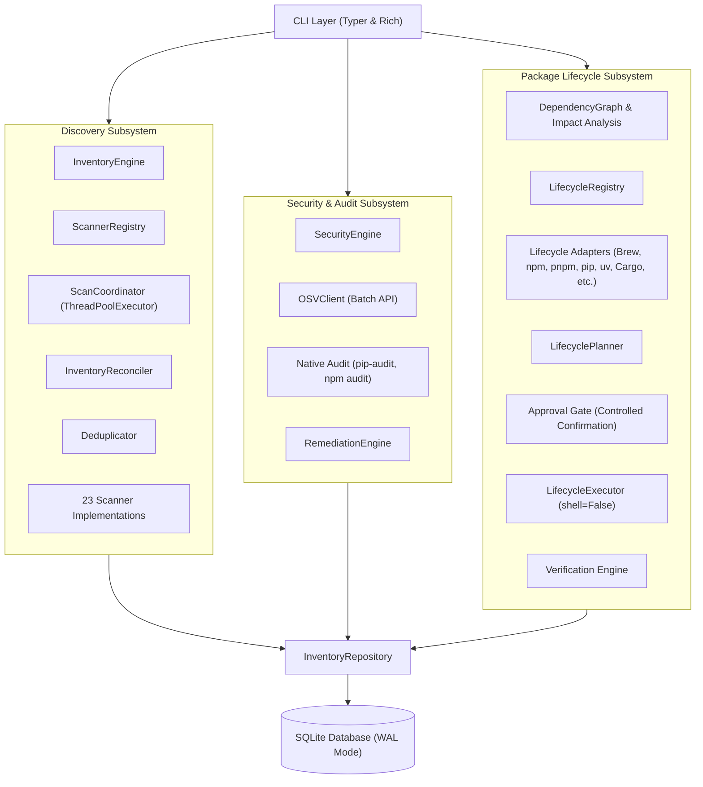

# Architecture Documentation — Inventory CLI (`inv`)

## 1. High-Level Architectural Overview

`inv` is designed with modularity, concurrency safety, strict separation of concerns, and a controlled package lifecycle & security management engine.

---

## 2. Layer Descriptions

### 2.1 CLI Interface Layer (`src/inv/cli.py`)
- Built using **Typer** and **Rich**.
- Provides discovery commands, package inspection, lifecycle management, security audits, and operation history.
- Does not run expensive discovery scans automatically on view commands; queries existing SQLite state for instant response times (< 50ms).

### 2.2 Core Orchestration Layer (`src/inv/core/`)
- **`engine.py`**: Coordinates scan lifecycles, configuration overrides, execution dispatching, and atomic transaction persistence.
- **`coordinator.py`**: Manages parallel execution across enabled scanners using `concurrent.futures.ThreadPoolExecutor`, bounded concurrency, per-scanner timeouts, and thread-safe cancellation tokens.
- **`reconciler.py`**: Reconciles unverified project dependencies with discovered global packages and installed virtual environments.
- **`deduplicator.py`**: Detects executable command shadowing across `$PATH` and multi-manager software installations.
- **`coverage.py`**: Calculates completeness metrics and scan age.
- **`dependency_graph.py`**: Directed dependency graph model evaluating direct, transitive, and reverse dependencies, and calculating risk profiles for removals and upgrades.

### 2.3 Scanner Adapters (`src/inv/scanners/`)
- All scanners inherit from `BaseScanner` (`base.py`) which guarantees safe execution via the `execute()` wrapper.
- Structured output is prioritized wherever supported by package managers.
- `probe.py` maintains an allowlist registry of commands with pre-approved read-only argument lists.

### 2.4 Package Lifecycle Adapters (`src/inv/adapters/`)
- Abstract `BaseLifecycleAdapter` defines contract for package operations: `check_outdated`, `install`, `remove`, `upgrade`, `list_versions`, `resolve_dependencies`, `verify_installation`.
- Input validation: Strict regex enforcement on package names and version specifications (`validate_package_name`, `validate_version_spec`).
- Dedicated adapters for:
  - **Homebrew** (`homebrew.py`): Formulae and casks with reverse dependency analysis via `brew uses --installed`.
  - **npm** (`npm.py`) & **pnpm** (`pnpm.py`): Global package management.
  - **pip** (`pip.py`): Virtualenv package management with PEP 668 system python protections.
  - **uv** (`uv.py`): Isolated tool management (`uv tool`).
  - **Cargo** (`cargo.py`): Rust binary crate installations.
  - **Bun** (`bun.py`) & **Yarn** (`yarn.py`): Modern JavaScript package managers.
  - **Unsupported / Read-Only** (`unsupported.py`): Explicit read-only adapter for MacPorts, Gem, Composer, Go, Conda.
- `LifecycleRegistry`: Central lookup and alias resolver preventing ambiguous package manager operations.

### 2.5 Lifecycle Planning & Execution (`src/inv/lifecycle/`)
- **`planner.py`**: Translates user requests into immutable `LifecyclePlan` objects, evaluating dependency risks, reverse dependencies, and rollback guidance.
- **`approvals.py`**: Enforces default-NO confirmation prompts in interactive terminals (`sys.stdin.isatty()`) and rejects execution in non-interactive environments.
- **`executor.py`**: Executes approved plans using strict argument vectors (`shell=False`), captures outputs, enforces timeouts, records events, and triggers post-execution verification.
- **`verification.py`**: Re-probes the host system post-operation to confirm desired package state.
- **`rollback.py`**: Assesses ecosystem rollback capabilities and logs recovery instructions.

### 2.6 Security & Vulnerability Subsystem (`src/inv/security/`)
- **`osv.py`**: Batch client for OSV.dev API (`https://api.osv.dev/v1/querybatch`), querying package vulnerabilities by ecosystem (PyPI, npm, crates.io, Go, etc.).
- **`advisories.py`**: Integrates native tool audits (`pip-audit`, `npm audit`).
- **`engine.py`**: Orchestrates security queries across all discovered installations and project lockfiles, deduplicating advisories across CVE, GHSA, and OSV identifiers.
- **`severity.py`**: Normalizes CVSS v3 vectors and textual ratings into standard severity levels (`CRITICAL`, `HIGH`, `MEDIUM`, `LOW`, `UNKNOWN`).
- **`remediation.py`**: Computes conservative, non-breaking remediation plans for fixable advisories, targeting minimum non-vulnerable versions.
- **`reporting.py`**: Terminal tables, summaries, and JSON export for vulnerability reports.

### 2.7 Storage Layer (`src/inv/storage/`)
- **`database.py`**: SQLite connection factory configuring WAL (`Write-Ahead Logging`) mode, foreign keys (`PRAGMA foreign_keys = ON`), and immediate transactions.
- **`migrations/`**: Schema migrations supporting version 1 (inventory) and version 2 (vulnerabilities, lifecycle operations, operation events, outdated packages).
- **`repositories.py`**: Repository abstraction for CRUD operations, universal search, vulnerability tracking, and operation audit trails.
