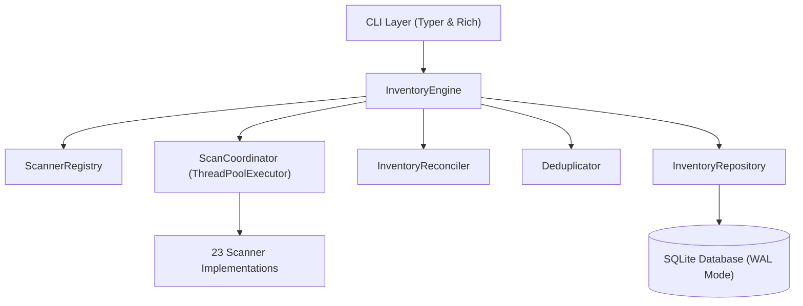

# Architecture Documentation — Inventory CLI (`inv`)

## 1. High-Level Architectural Overview

`inv` is designed with modularity, concurrency safety, and strict separation of concerns.

## 2. Layer Descriptions

### 2.1 CLI Interface Layer (`src/inv/cli.py`)
- Built using **Typer** and **Rich**.
- Provides 19 subcommands with default fallback to summary overview when invoked without arguments (`inv`).
- Does not run expensive discovery scans automatically on view commands; queries existing SQLite state for instant response times (< 50ms).

### 2.2 Core Orchestration Layer (`src/inv/core/`)
- **`engine.py`**: Coordinates scan lifecycles, configuration overrides, execution dispatching, and atomic transaction persistence.
- **`coordinator.py`**: Manages parallel execution across enabled scanners using `concurrent.futures.ThreadPoolExecutor`, bounded concurrency, per-scanner timeouts, and thread-safe cancellation tokens.
- **`reconciler.py`**: Reconciles unverified project dependencies with discovered global packages and installed virtual environments.
- **`deduplicator.py`**: Detects executable command shadowing across `$PATH` and multi-manager software installations.
- **`coverage.py`**: Calculates completeness metrics and scan age.

### 2.3 Scanner Adapters (`src/inv/scanners/`)
- All scanners inherit from `BaseScanner` (`base.py`) which guarantees safe execution via the `execute()` wrapper.
- Structured output is prioritized wherever supported by package managers.
- `probe.py` maintains an allowlist registry of commands with pre-approved read-only argument lists.

### 2.4 Storage Layer (`src/inv/storage/`)
- **`database.py`**: SQLite connection factory configuring WAL (`Write-Ahead Logging`) mode, foreign keys (`PRAGMA foreign_keys = ON`), and immediate transactions.
- **`migrations/`**: Schema migrations with version tracking table.
- **`repositories.py`**: Repository abstraction for CRUD operations and universal search.
